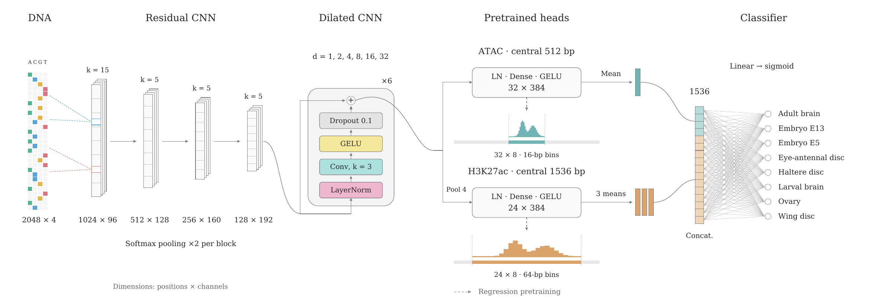

# Enhancer pleiotropy model

Sequence models that predict, from 2,048 bp of DNA, whether a *Drosophila melanogaster*
enhancer is active in each of eight developmental contexts: adult brain (`ab`), embryo
stage 13 (`e13`), embryo stage 5 (`e5`), eye-antennal disc (`ead`), haltere disc (`hid`),
larval brain (`lb`), ovary (`o`) and wing disc (`wid`).

Training has two stages:

1. **Pretraining** — a *regressor* predicts ATAC-seq and H3K27ac profiles genome-wide.
2. **Classification** — a *classifier* predicts enhancer activity in each context, starting
   from the pretrained regressor or from random weights.

This repository builds the training data, trains every model in the manuscript, calibrates the
classifiers, predicts on new sequences and computes attribution maps (integrated gradients).
The input data come from [drosophila-cCREs](https://github.com/laiker96/drosophila-cCREs).



*The manuscript model: dilated CNN, pretrained, 1,244,168 parameters. Dashed branches are used
only during pretraining. [SVG](docs/figures/best_model_architecture.svg) ·
[PDF](docs/figures/best_model_architecture.pdf)*

## Requirements

- Linux.
- An NVIDIA GPU with ≥ 6 GB of memory. CPU is fine for the tests and for prediction.
- 16 GB RAM, and 4 GB of disk for the prepared datasets.
- [Miniforge](https://github.com/conda-forge/miniforge) (`mamba`) or conda.

## Installation

```bash
git clone https://github.com/laiker96/enhancer_pleiotropy_model.git
cd enhancer_pleiotropy_model
mamba env create -f environment.yml   # Python 3.11, PyTorch 2.5.1 (CUDA 12.1), pyBigWig, ...
mamba activate epm
pytest                                # optional, ~2 min on CPU: the whole pipeline on synthetic data
```

This installs the `epm` command. For another CUDA version, or for CPU only, change the
PyTorch index URL in `environment.yml`.

## Quick start

Run the commands from the repository root. Each reads its settings from `configs/`, and any
value can be overridden with `--set key=value`.

**1. Prepare the data** (about 15 min on CPU). First run drosophila-cCREs through its `qc`,
`master` and `catalog` stages, and set `ccre:` in [`configs/data.yaml`](configs/data.yaml) to
that checkout. Then:

```bash
epm prepare-data
```

**2–3. Train a regressor, then a classifier** (GPU):

```bash
epm train-regressor  --architecture cnn
epm train-classifier --architecture cnn --init pretrained --seed 20260914   # or --init scratch
```

**4. Calibrate and predict:**

```bash
epm calibrate runs/classifiers/cnn_pretrained_20260914
epm predict runs/classifiers/cnn_pretrained_20260914/best_model.pt \
    --bed regions.bed --genome dm6.fa --output predictions.tsv
```

The output has one row per region:

- `p_<context>` — the calibrated probability of activity in each context;
- `predicted_breadth` — their sum, the expected number of active contexts.

**5. Compute attribution maps** for every enhancer. This is GPU-heavy; split it across jobs:

```bash
epm attribute --shard 0 --shards 8   # ... through --shard 7
```

`epm manuscript` lists the 35 runs of the paper's architecture comparison (5 regressors and
30 classifiers). Every command has `--help`.

## Documentation

- [Usage details](docs/usage.md) — reproducing all models (including on Slurm), run times,
  configuration, inputs from drosophila-cCREs, and output files including the attribution format.
- [Methods](docs/methods.md) — data, architectures, training, calibration, attribution, and how
  the code was verified against the manuscript.

On the same inputs, the code reproduces the manuscript's training data exactly. With the same
hardware and software it also reproduces the trained weights bit for bit. See
[Methods](docs/methods.md#reproducibility).

## Citation and license

If you use this code, please cite the manuscript (citation to be added on publication).

Released under the [MIT License](LICENSE). The pretraining loss is adapted from
[AlphaGenome](https://github.com/google-deepmind/alphagenome_research) under the Apache License 2.0
([notice](LICENSES/AlphaGenome-Apache-2.0.txt)).
